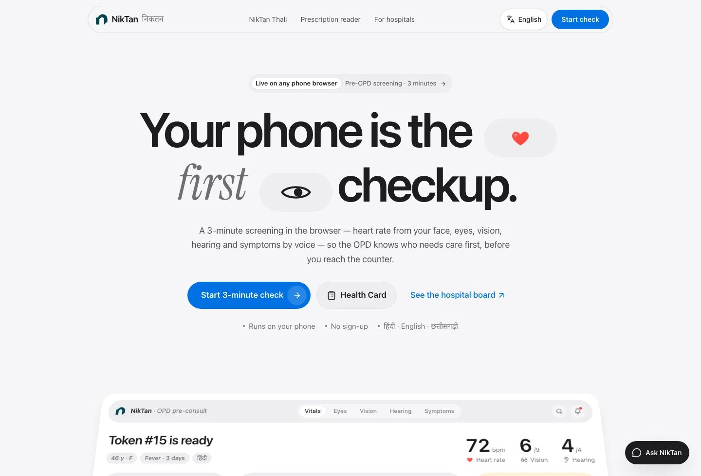
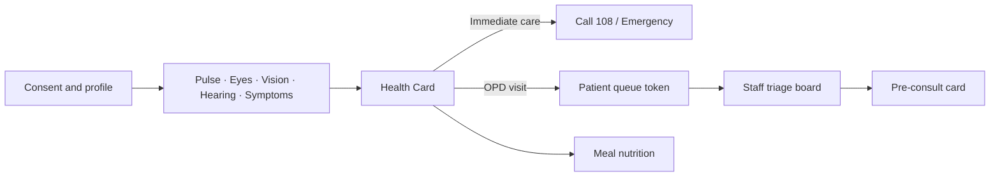
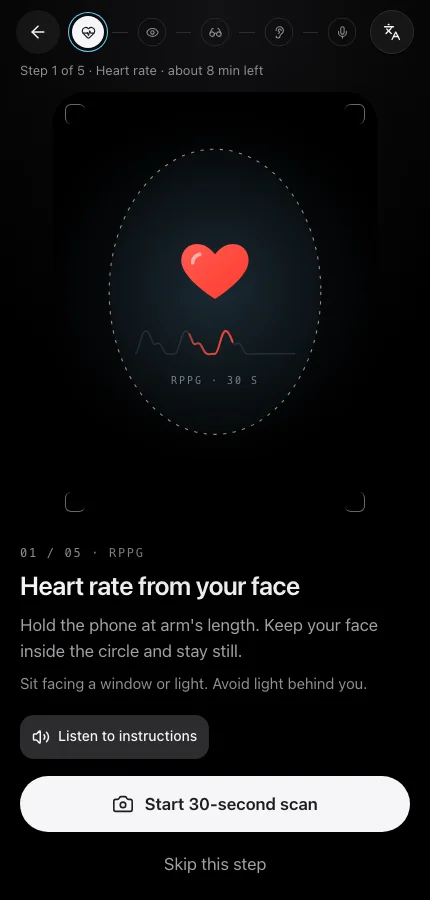
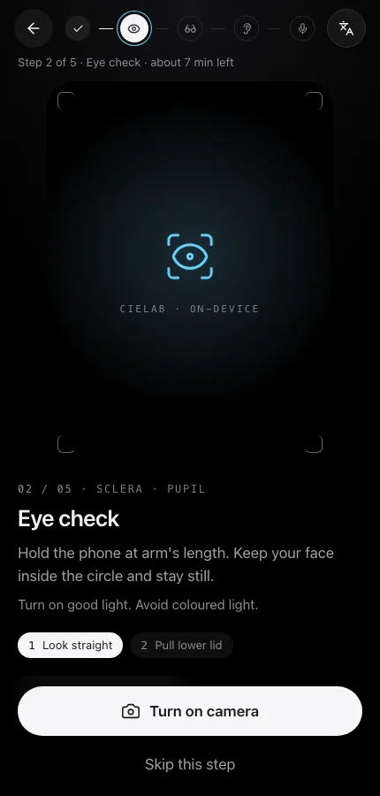
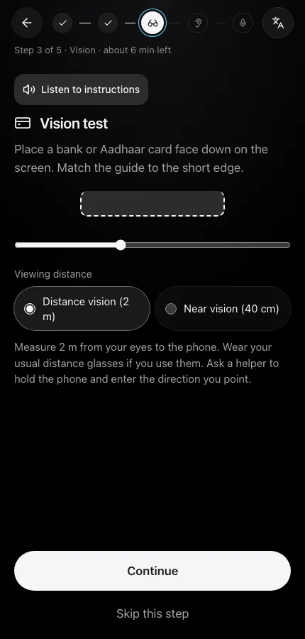
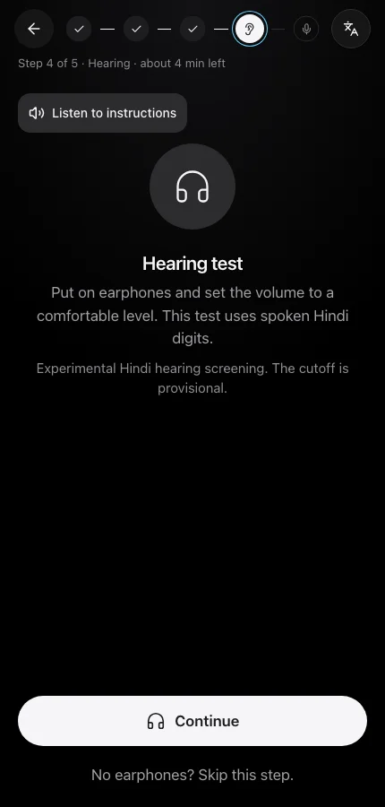
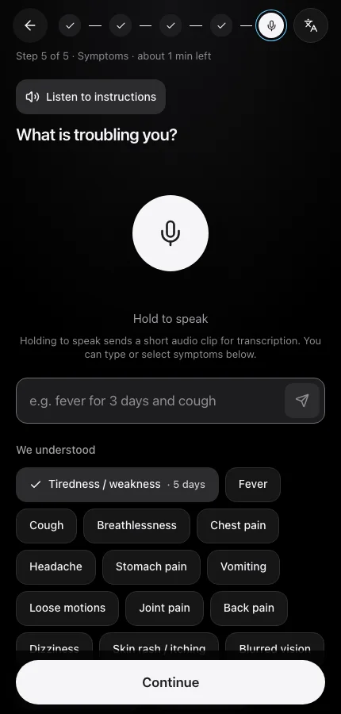
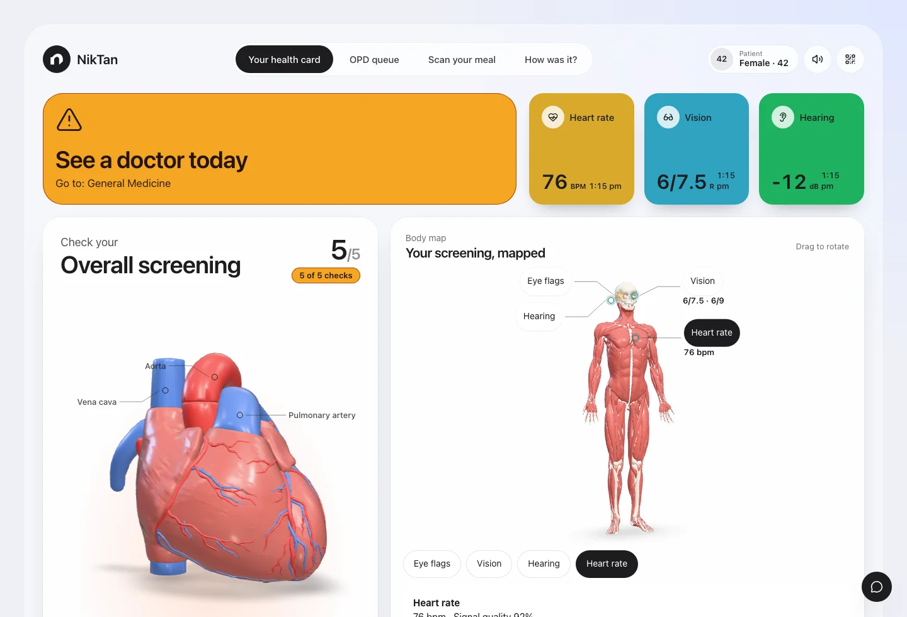
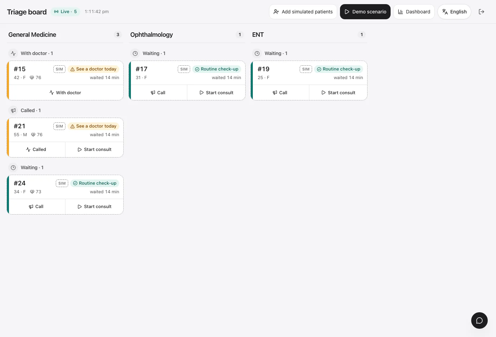
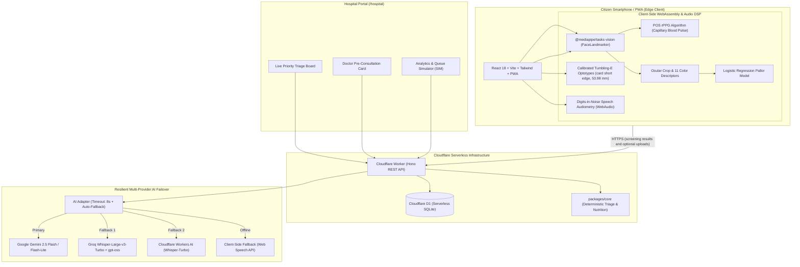

<p align="center">
  
</p>

# NikTan (निकतन)

> **"तबियत कइसन हे? तीन मिनट म जाँच लव।"**  
> *"Your phone is the first checkup. The OPD knows you before you arrive."*

[-8b5cf6.svg)](https://iiitnr.ac.in)
[](https://niktan.vercel.app/)
[](https://workers.cloudflare.com)
[-success.svg)](docs/architecture.md)
[](packages/core/test)

**NikTan** (from Chhattisgarhi *"nik"* = good/healthy + *"tan"* = body) is an edge-first, multimodal pre-consultation health screening and clinical triage system built for **Hackasol 5.0 (OI-01: Build for Real-World Impact)**.

A registration token tells a doctor who arrived first. NikTan adds the reason someone may need to be seen sooner. Patients can check pulse and eyes and describe symptoms in a **Quick check** (about 3 minutes). The **Full check** adds vision and hearing (about 8 minutes total). Both times are estimates.

The Health Card explains the next step. Emergency flags surface a call to 108. For an OPD visit, the patient can join a department queue and the doctor can open a pre-consult card with findings and checks to repeat at the desk.

**[One-page problem validation summary (PDF)](docs/niktan-validation.pdf)** · [Try the prototype](https://niktan.vercel.app/) · [See the product tour](docs/product-tour.md)

---

## Product walkthrough

[](https://niktan.vercel.app/)



| Face pulse | Eye check | Vision | Hearing | Symptoms |
|---|---|---|---|---|
| [](docs/images/live/face-vitals.webp) | [](docs/images/live/eye-check.webp) | [](docs/images/live/vision-test.webp) | [](docs/images/live/hearing-test.webp) | [](docs/images/live/symptoms.webp) |

| Health Card | Hospital triage board |
|---|---|
| [](docs/images/live/health-card.webp) | [](docs/images/live/staff-board.webp) |

Screenshots come from the deployed web app. Sample health results, queue tokens and staff views use synthetic data. The anatomy models are adapted from BodyParts3D © DBCLS, CC BY 4.0. [Full screenshot gallery and walkthrough](docs/product-tour.md) · [Anatomy attribution](apps/web/public/models/ATTRIBUTION.txt)

## Quick Navigation

- [Product walkthrough](#product-walkthrough)
- [Problem Validation & Real-World Evidence](#problem-validation-and-evidence)
- [Measurable Quantitative Impact](#measurable-impact-before--after)
- [System Architecture & Privacy Pipeline](#architecture-and-data-flow)
- [Advanced Clinical & Diagnostic Features](#advanced-clinical-features--modules)
- [NikTan Thali: Culturally Rooted Nutrition](#niktan-thali-nutrition-engine)
- [Hospital Triage Board & Staff Demo Access](#hospital-side-triage-board--staff-pins)
- [Local Development & Quickstart](#run-the-prototype-locally)
- [Population-Scale Cost Analysis](#population-scale-cost-analysis)
- [In-Depth Technical Documentation (`docs/`)](#technical-documentation-index)

---

## Problem Validation and Evidence

In a 255-patient study at one North Indian government teaching hospital, patients reported a mean **242.8-minute wait** until called and a **12.8-minute consultation**. NikTan addresses one part of that experience: identifying urgency and preparing the clinician before a consultation. [Published study](https://doi.org/10.18203/2394-6040.ijcmph20264093) · [Validation evidence and pilot plan](docs/validation.md)

The home page includes a 46-second launch film and shows two feedback sources. The post-check survey collects reported OPD wait and willingness to use NikTan. Hackasol teams can use **Rate NikTan** in the footer to review features they tried and leave a public remark. [Team review form](https://niktan.vercel.app/review)

## Measurable Impact (Before / After)

| Measure | Before | With NikTan | Basis |
|---|---|---|---|
| Queue position for token 15 | 14 people ahead | **0 ahead** | Synthetic D1 benchmark with 14 routine patients and one see-today arrival |
| Doctor intake time | Baseline to be timed on site | Target of 0.5–1 minute | Planned field pilot |
| Server cost at scale | — | Estimated ₹0.022 per screening | [100,000-screening monthly scenario](docs/cost.md) |

> **See it live:** the hospital board shows *"Today vs first-come, first-served"*, and the admin dashboard shows per-priority bars. Both come from the queue's own timestamps. The counterfactual hands the doctor's real call times to the same patients in arrival order (same capacity, different order). Emergency bypasses are put back into the General Medicine line they would have joined. Routine patients waiting slightly longer is shown, not hidden.
>
> **Reproduce the Priority Queue Benchmark:**  
> In `apps/api/test/d1.test.mjs`, 14 routine synthetic visits were waiting in General Medicine. A 15th patient arrived reporting 3 days of acute fever. Arrival order placed the patient at position 15. NikTan's deterministic triage classified the case as **🟠 See Today**, reprioritizing the patient to **0 ahead (1st in line)** while preserving ticket #15. Run: `pnpm --filter @niktan/api test`. Full evaluation metrics in [`docs/metrics.md`](docs/metrics.md).

---

## Architecture and Data Flow

NikTan is engineered with an **Edge-First, Zero-Knowledge Privacy Architecture**. Heavy computer vision and audio DSP run entirely inside the client's browser WebAssembly runtime. Raw camera streams and ocular frames never touch a server or third-party AI provider, in a design aligned with India's **Digital Personal Data Protection (DPDP) Act 2023** (not a legal certification). Voice recordings and meal photos are sent to AI providers when online; face video and eye photos never leave the phone.



See [`docs/architecture.md`](docs/architecture.md) for full sequence diagrams, security threat models, and D1 database entity-relationship specifications.

---

## Advanced Clinical Features & Modules

### M1: In-Browser Contactless rPPG Heart Rate
- **Algorithms:** Three published pulse extractors run on each skin region and are fused by signal quality: **POS** (Wang et al., [IEEE TBME 2017](https://doi.org/10.1109/TBME.2016.2609282)), **CHROM** (de Haan & Jeanne 2013) and an **OMIT**-style orthogonal projection (Casado & López 2023).
- **Implementation:** MediaPipe FaceLandmarker tracks forehead and both cheeks (eyes and mouth masked). A region hidden by hair, a beard or glare is dropped on its own; the other regions still carry the pulse.
- **Signal Processing:** Motion and lighting steps are clipped before extraction, then band-pass (**0.7 – 3.0 Hz**, 42–180 bpm), SNR-weighted spectral fusion, harmonic-sum peak picking and Viterbi tracking across 10-second windows. Works from **6 processed frames per second**, so budget phones running the face model on the CPU still get a reading.
- **Quality Gate:** Rejects large motion, head turns over 25°, and unusable light with spoken guidance ("कृपया स्थिर रहें", "बढ़िया रोशनी में आइए"). The camera watchdog judges a stall by video progress, not processing speed, so slow phones are not mistaken for a lost camera.
- **Live Display:** A Kalman-smoothed rate, a patient-monitor pulse trace, and a heart and face regions that pulse on each *detected* beat, in phase with the drawn peak.
- **Verification:** 70 unit tests, including frame-rate and stutter sweeps (6–30 fps) and coloured head-jerk artefacts, plus an end-to-end browser run on a synthetic camera that read 72 and 96 bpm exactly.

### M2: Ophthalmic Multi-Condition Screening
- **Conjunctival Pallor (Anemia Screening Flag):** MediaPipe automatically crops the inferior palpebral conjunctiva as the patient gently pulls the lower eyelid down. Extracts 11 normalized colorimetric features across CIELAB ($L^*, a^*, b^*$), normalized red/green ratios, and erythema indices.
- **Machine Learning Model (v2):** A logit blend of logistic regression (70%) and 200 depth-2 boosted trees (30%), trained on 731 pooled clinical samples (Ghana pediatric ML IDA dataset + Indian/Italian adult Eyes-defy-anemia dataset, CC BY 4.0). Trees alone score higher but transfer worse between countries, so the blend keeps cross-population behaviour close to the logistic model.
- **High-Sensitivity Calibration:** Grouped cross-validated AUC **0.743** (v1: 0.707), sensitivity **84%**, specificity **43%** (v1: 39%), with frequent false-positive referrals at this sensitivity-oriented operating point. Browser and Python inference match to 1e-9. Detailed model card: [`docs/model-card-anemia.md`](docs/model-card-anemia.md).
- **Jaundice screen (v2):** the sclera is segmented from the eyelid landmarks, and an optional white paper under the chin is detected automatically to cancel the room light's colour (BiliScreen / neoSCB approach). The screen acts as a flash over three frames. Yellowness is fused with two symptom questions (yellow eyes noticed, dark urine) into low / possible / likely.
- **Cataract screen (v2), works on every phone:** pupil opacity is measured against the same eye's sclera (so dark brown irises don't hide it), with the screen as the light source. A **glare-disability test** (contrast letters inside a bright ring, age 40+) and cataract symptoms (cloudy vision, night glare) are fused with age and acuity. Method, thresholds and limits: [`docs/eye-screening.md`](docs/eye-screening.md).

### M3: Clinically Calibrated Tumbling-E Visual Acuity
- **Physical Calibration:** User matches an on-screen slider to the short edge of any standard ID-1 card (Aadhaar / ATM card, 53.98 mm) to derive exact screen pixels-per-millimeter ($PPM$).
- **Dual Testing Modes:**
  1. *40 cm Near Mode:* Monocular testing at an instructed 40 cm distance (camera-based distance tracking is not yet used).
  2. *2 m Far Mode:* Assisted distance acuity with directional taps or swipes.
- **Standardized Snellen Output:** 0.1 logMAR staircase with 5 optotypes per tier; referral boundary calibrated to worse than 6/12 (or $\ge 2$ lines difference between eyes) per WHO guidelines.

### M4: Digits-in-Noise (DIN) Speech Audiometry
- **Methodology:** Experimental, diotic digits-in-noise screen for adults (the method behind WHO hearWHO), using Hindi digit triplets (e.g., "३ ७ २") in speech-shaped noise. The pass/refer cut-off comes from published non-Hindi DIN research and is provisional until calibrated on local normal-hearing listeners.
- **Adaptive Staircase:** 1-up-1-down SNR adaptation over 23 triplets. Evaluates speech recognition threshold (SRT) in decibels SNR.
- **Audio:** The Hindi digit and voice-guide recordings in `apps/web/public/audio` were synthesised with eSpeak NG (via the Echogarden toolkit); replace them with recorded human speech before any clinical use.

### M5: Multimodal Voice Symptom Structuring
- **Push-to-Talk Speech Capture:** Patients speak naturally in Hindi, Chhattisgarhi, or Hinglish ("3 दिन से बुखार है और खाँसी आ रही है").
- **Multi-Tiered ASR Failover:** Groq Whisper Large-v3-Turbo $\rightarrow$ Cloudflare Workers AI Whisper $\rightarrow$ In-browser Web Speech API (`hi-IN`).
- **Constrained Medical Structuring:** Structured by LLM (Gemini Flash / Groq) into a strict Zod-validated schema with a closed 40-item bilingual clinical vocabulary (`packages/core/src/data/symptoms.json`).
- **Emergency Safety Double-Confirmation:** Confirms life-threatening red flags (chest pain, acute dyspnea, pregnancy bleeding, seizures) before routing.

### M6: Deterministic Priority Triage Engine
- **Clinical Protocol:** Emergency Severity Index (ESI) and Manchester Triage inspired rule engine (`packages/core/src/triage.ts`).
- **Triage Tiers:**
  - 🔴 **EMERGENCY:** Critical vital signs (HR > 130 or < 40 bpm) or confirmed red flags $\rightarrow$ Bypasses the OPD queue and shows a direct `tel:108` button. It does not notify the hospital; a patient already in a queue who becomes an emergency is re-triaged to the top of the board.
  - 🟠 **SEE TODAY:** Moderate vital deviations, fever $\ge 3$ days, acute pallor with fatigue, or sudden sensory loss $\rightarrow$ Elevated to top priority in OPD queue.
  - 🟢 **ROUTINE:** Stable presentations $\rightarrow$ Sorted by arrival order.
- **Automated Department Routing:** Routes to 8 specialized departments (General Medicine, Pediatrics for age < 14, Obstetrics & Gynecology, Ophthalmology, ENT, Orthopedics, Dermatology, Surgery).
- **Coverage Gaps:** Skipped or unreliable checks are returned as desk actions ("Heart-rate signal unclear: take pulse at the desk") and shown on the doctor's card.
- **Acuity Score:** A 0–100 ordering hint inside each priority tier (emergency 80+, see-today 40–79, routine 0–39) from the number of reasons, pulse deviation for age, severe symptoms and age extremes. It never moves anyone between tiers.

### M7: Health Papers (`/rx`): Prescription, Medicine Saver, Lab report
One page, three tools, each opened on its own (`/rx`, `/rx?tool=saver`, `/rx?tool=lab`).
- **Prescription:** Photograph or paste a printed or handwritten prescription. Two vision readers run in parallel and are merged line by line; disagreements are marked for the pharmacist. Indian shorthand (OD, BD, TDS, HS, SOS, AC/PC, 1-0-1) is explained. A built-in list of ~200 common Indian brands (Dolo, Pan-D, Augmentin, Montair LC, Telma, Glycomet…) fills the salt for clearly read brand names without another AI call. Uses, warnings and side effects come from **NLM RxNorm** and **openFDA**; "Find a cheaper generic" checks Jan Aushadhi.
- **Medicine Saver:** Photograph a strip or box (or type a brand or salt). The label's composition, MRP and expiry are read (expired and expiring-soon packs are flagged), and the matching **Jan Aushadhi (PMBJP)** generic is found by ingredients, strength and form with its government MRP and per-tablet saving. Data: the official Product & MRP List, converted with `node apps/api/scripts/janaushadhi.mjs <download.csv>`.
- **Lab report:** Photograph or paste a report. The AI only transcribes rows; Low/High/In range flags are computed in code from the range printed on the report (or a typical adult range when none is visible, labelled as such), with plain-language notes for ~25 common tests in English and Hindi and a "see a doctor today" alert for far-out values.
- **Speed:** Readings are cached at the edge for an hour by a hash of the exact input, so a retry or a second scan of the same photo answers instantly.
- **Safety:** Never suggests changing a dose or switching a medicine without the doctor or pharmacist; photos are sent only for reading and not stored.

### M8: NikTan Sahayak, the Help Assistant
- A chat assistant on every page except the camera steps, powered by **Groq** (`gpt-oss-120b`) with Workers AI as backup. It answers from a curated knowledge base of NikTan's features, results, Thali, Health Papers, hospitals and privacy, replies in English, Hindi or Chhattisgarhi, links to the right page, never diagnoses, and leads with **108** for emergencies. Phone and Aadhaar-like numbers are masked before text leaves the server.

---

## NikTan Thali: Nutrition Engine

NikTan closes the clinical loop by linking screening observations (e.g., conjunctival pallor) with nutritional dietary interventions:
1. **Computer Vision Dish Recognition:** Meal photos are analyzed via Gemini Flash Vision against a catalogue of **131 dishes from every region of India** (Chhattisgarh home food, South, North, West, East and North-East, street food, fruits and drinks), each with local names for search and recognition. Look-alike rules (dal colours, puri vs bhatura, dosa vs uttapam) and portion cues are in the prompt, and labels the model returns are mapped back to dishes through their local names. Nutrient values come from the Indian Nutrient Databank, with newer dishes estimated from IFCT 2017 ingredients and marked `est` (the INDB data files carry no explicit licence; ask the authors before redistribution).
2. **Deterministic Nutritional Calculation:** Computes macronutrients and micronutrients (protein, iron, calcium, vitamin C, dietary fiber) derived from the **Indian Nutrient Databank (INDB)** and ICMR-NIN IFCT 2017.
3. **ICMR-NIN RDA 2020 Targets:** Compares meals against age- and sex-adjusted reference daily intakes.
4. **Culturally Grounded Central Indian Swaps:** Recommends hyper-local, affordable alternatives:
   - *Pallor / Low Iron:* Promotes **Lal Bhaji** (red amaranth), **Kulthi Dal** (horsegram), **Kala Chana**, and citrus pairings (guava/amla) for iron bioavailability.
   - *Energy / Gut Health:* Integrates traditional fermented **Bore-Baasi** and indigenous millets (**Kodo / Kutki**).

---

## Hospital-Side Triage Board & Staff PINs

Staff access the live clinical triage board at `/hospital`.

```
/hospital
 ├── Live Triage Board (real-time priority ordering, token status, wait times)
 ├── Doctor Pre-Consultation Card (vitals, ocular flags, Snellen score, symptoms, clinical notes)
 ├── Administrative Analytics (footfall, department load, referral rates)
 └── Demo Simulator (seeds realistic synthetic patients tagged with [SIM])
```

### Demo Credentials

| Role | Public Demo PIN | Scope |
|---|---|---|
| **Staff Nurse** | `2468` | Review live priority queue, call patients, add simulated patients |
| **Medical Officer (Doctor)** | `1357` | Inspect pre-consultation card, record notes, close visits, add simulated patients |
| **Hospital Admin** | `9090` | Seed synthetic OPD patients (**SIM**) and review analytics |

*Note: Public demo PINs see simulated records, plus any real visit whose citizen ticked **Show my visit on the demo board** when joining a demo hospital (age, sex and results only, never a name). A judge can scan on their own phone and watch the visit appear on the board with a **LIVE** badge. Private staff accounts are provisioned via `apps/api/scripts/staff.mjs`.*

### Operations & Accountability Endpoints

| Route | Access | Purpose |
|---|---|---|
| `GET /api/stats/public` | Public | Screening count and anonymous post-check survey aggregates |
| `GET /api/reviews` · `POST /api/reviews` | Public | Read visible team reviews or submit feature ratings and a remark |
| `GET /api/health` | Public | Liveness probe (version and build only, no database work) |
| `GET /api/hospital/:hid/board` | Staff | Live board; send `If-None-Match` with the last `ETag` to get a cheap `304` while nothing changed |
| `GET /api/hospital/:hid/impact` | Staff | Today's priority queue vs. first-come-first-served: minutes saved per priority, real-only and with simulated visits, plus doctor-rated usefulness of the pre-filled history |
| `GET /api/hospital/:hid/audit?limit=50` | Admin | DPDP audit trail (logins, token moves, note saves, simulator use), newest first, max 200 |

Every response carries `X-Request-Id` and `Server-Timing`; error bodies include `requestId` so it can be quoted in a bug report. JSON bodies are capped at 64 KB. Real screenings are kept for `RETENTION_DAYS` (default 30), simulated visits for 2 days, thali scans for 7 days and audit entries for 180 days.

---

## Trilingual Localization

NikTan supports full trilingual localization with a native speaker focus for Chhattisgarh:
- **हिंदी (Hindi):** Primary language with synthesized speech guidance.
- **छत्तीसगढ़ी (Chhattisgarhi):** Authentic state vernacular (`apps/web/src/i18n/hne.json`) tailored for rural outpatients in Central India ("तबियत कइसन हे?", "पहिली जाँच तोर मोबाइल").
- **English:** Full clinical parity for medical staff and administrators.

---

## Run the Prototype Locally

### Prerequisites
- Node.js 20 or 22
- pnpm 9 or 10

### Setup & Launch
```sh
# 1. Clone and install dependencies
git clone https://github.com/ewwhardik/niktan.git
cd niktan
pnpm install

# 2. Run local database migrations
pnpm --filter @niktan/api db:migrate:local

# 3. Execute test suite and type checking
pnpm test
pnpm typecheck
pnpm build

# 4. Start local development servers
# Terminal 1: Backend API (Port 8787)
pnpm dev:api

# Terminal 2: Frontend PWA (Port 5173)
pnpm dev:web
```

Open [http://localhost:5173](http://localhost:5173) in your browser. Open [http://localhost:5173/status](http://localhost:5173/status) to view live database connectivity and multi-provider health.

---

## Population-Scale Cost Analysis

Because all biometric processing occurs on the citizen's phone, server operating costs are minimal:

| Component | Usage for 100,000 Screenings | Monthly Cost (INR) | Monthly Cost (USD) |
|---|---|---|---|
| **Cloudflare Workers** (API) | ~1.5M requests | ₹425 | $5.00 |
| **Cloudflare D1** (SQLite) | ~1M writes / 15M reads | Included in $5 Workers tier | Included |
| **Groq Whisper Large-v3-Turbo** | ~50k voice sessions | ₹690 | $8.25 |
| **Google Gemini 2.5 Flash** | ~80k structuring calls | ₹550 | $6.60 |
| **Gemini Flash Vision** | ~30k thali scans | ₹325 | $3.90 |
| **Cloudflare Workers AI** | Overflow failovers | ₹200 | $2.40 |
| **TOTAL** | **100,000 Citizens** | **~₹2,190 – ₹2,900 / mo** | **~$26 – $35 / mo** |

**Cost per screening:** **₹0.038 (under 4 paise)**. Compare this to ₹50–200 for a single lab Hb test. Full economic details: [`docs/cost.md`](docs/cost.md).

---

## Technical Documentation Index

For comprehensive implementation blueprints, benchmarks, and clinical reviews:

| Document | Description |
|---|---|
| [`docs/eye-screening.md`](docs/eye-screening.md) | Jaundice and cataract v2: white-referenced sclera colour, pupil opacity, glare test, symptom fusion, thresholds |
| [`docs/audit.md`](docs/audit.md) | Audit against every OI-01 requirement: why it wins, where it could fail, what was fixed |
| [`docs/product-tour.md`](docs/product-tour.md) | Screenshots of citizen, screening and hospital workflows with capture details |
| [`docs/design-roadmap.md`](docs/design-roadmap.md) | Interaction design decisions, responsive checks and screening recovery |
| 📄 [`docs/validation.md`](docs/validation.md) | Clinical problem validation, OPD wait studies, ABDM Scan & Share analysis, planned validation |
| 📊 [`docs/metrics.md`](docs/metrics.md) | Quantitative evaluation metrics, before/after comparisons, queue integration test benchmarks |
| 💰 [`docs/cost.md`](docs/cost.md) | Costed plan for population-scale deployment (100k screenings/month, hospital tablet options) |
| 👁️ [`docs/model-card-anemia.md`](docs/model-card-anemia.md) | Machine learning model card for conjunctival pallor detection (features, datasets, ROC-AUC) |
| 🎬 [`docs/demo-script.md`](docs/demo-script.md) | Step-by-step 3-minute stage pitch and presentation guide for hackathon judging |
| 🏗️ [`docs/architecture.md`](docs/architecture.md) | Detailed architectural topology, sequence diagrams, security threat models, and D1 schemas |
| 🍽️ [`ml/anemia/README.md`](ml/anemia/README.md) | Python training scripts, feature extraction pipelines, and golden cross-validation fixtures |

---

## Ethical Principles & Safety Boundaries

1. **Non-Diagnostic Screening:** NikTan is explicitly an assistive pre-consultation triage tool. It does not replace a registered medical practitioner. All findings are phrased as risk tiers and recommendations for diagnostic laboratory confirmation.
2. **Emergency Protocol (Fail-Safe):** Confirmed life-threatening symptoms automatically bypass OPD queues and present immediate 108 emergency contact directives.
3. **On-Device Biometric Isolation:** Facial video streams and eye images are processed entirely within in-memory WebAssembly buffers and are destroyed upon step completion. No raw biometric imagery is ever transmitted or stored.

---

## Data, Models and Third-Party Assets

Nothing below is redistributed beyond what its licence allows; raw datasets are not in this repository.

| What | Used for | Source | Licence |
|---|---|---|---|
| ML IDA Conjunctiva Dataset from Ghana | Training the pallor model (derived coefficients only) | Asare, Appiahene, Donkoh, Mendeley Data V1 (2022), doi:10.17632/nt7r8hv2pz.1 | CC BY 4.0 |
| Eyes-defy-anemia | Training and per-country evaluation of the pallor model | Dimauro et al., IEEE DataPort (2022), doi:10.21227/t5s2-4j73 | CC BY 4.0 |
| Indian Nutrient Databank (INDB) | Dish nutrient values | Vijayakumar et al., *Curr Dev Nutr* 8(7):103790 (2024); github.com/lindsayjaacks/Indian-Nutrient-Databank-INDB- | Paper CC BY; data files carry no explicit licence |
| ICMR-NIN Nutrient Requirements 2020 / IFCT 2017 | Daily targets, raw-ingredient values | ICMR-National Institute of Nutrition, Hyderabad | Public reference |
| BodyParts3D v4.0 (heart and body 3D models) | Health-card anatomy views | © The Database Center for Life Science (DBCLS), dbarchive.biosciencedbc.jp/en/bodyparts3d; modified (decimated, recoloured, normalised) | CC BY 4.0 |
| MediaPipe FaceLandmarker | Face and iris landmarks in the browser | Google, `@mediapipe/tasks-vision` | Apache 2.0 |
| Hindi digit and guide audio | Hearing test and voice guidance | Synthesised with eSpeak NG via Echogarden | eSpeak NG is GPL-3.0 software; replace with recorded speech before clinical use |
| "EDM Detection Mode" (film soundtrack) | Music of the 46-second home-page launch film (three sections of the track, cut on the beat) | Kevin MacLeod, incompetech.com | CC BY 4.0 |
| Inter, Noto Sans/Serif Devanagari, Instrument Serif | Typography | Fontsource packages | SIL Open Font License |
| OPD waiting-time figures | Problem statement | Published Indian OPD time-motion studies, e.g. IJCMPH (ijcmph.com/index.php/ijcmph/article/view/16572); AIIMS Delhi OPD volumes; ABDM Scan & Share press release (PIB, 2026) | Cited, not redistributed |

## Team & Credits

**Designed and built by Sai Ram Dash**: [GitHub @ewwhardik](https://github.com/ewwhardik) · [LinkedIn @ewwhardik](https://www.linkedin.com/in/ewwhardik)

All product design, engineering, the rPPG and anaemia models, the triage engine, NikTan Thali, Health Papers (prescription, Medicine Saver, lab report) and the help assistant are by Sai Ram Dash.

- **Event:** Hackasol 5.0, IIIT Naya Raipur, Chhattisgarh.
- **Track:** Open Innovation (OI-01: Build for Real-World Impact).
- **Core Stack:** React 18, Vite, TypeScript, Tailwind CSS, MediaPipe Tasks Vision, WebAudio API, Hono, Cloudflare Workers, Cloudflare D1, Google Gemini API, Groq, and Workers AI.
