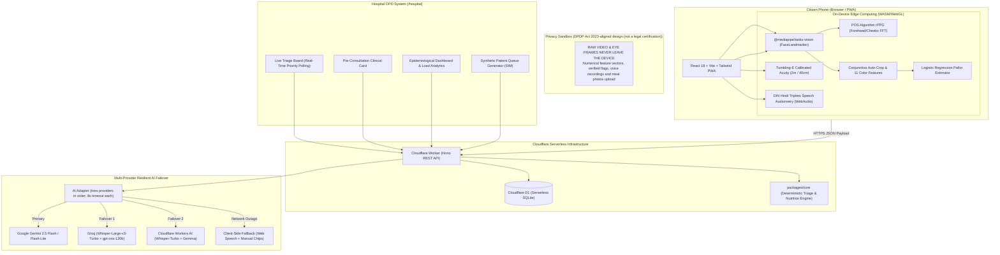
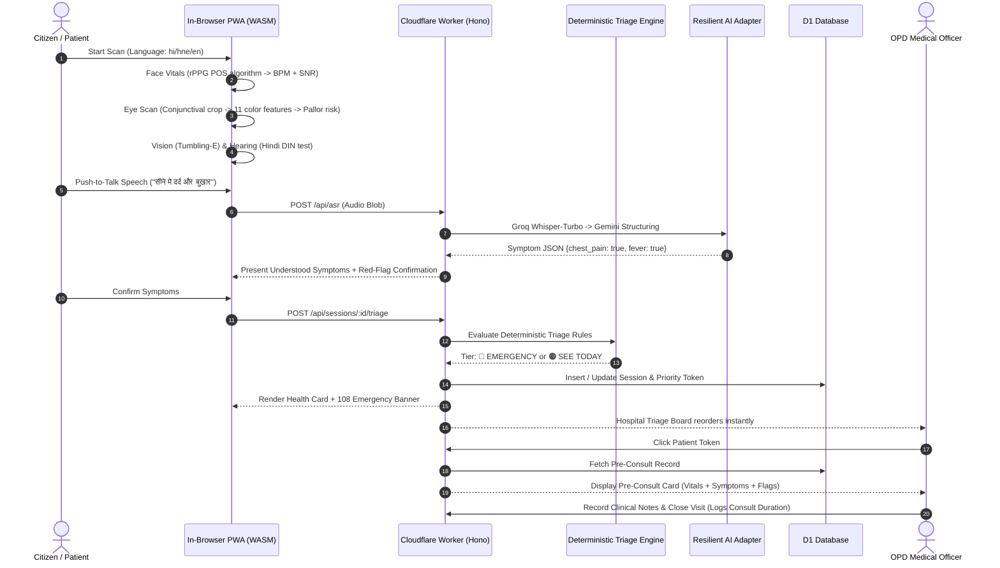

# NikTan Architecture & Technical Blueprint

> **Track:** Hackasol 5.0 · Open Innovation (OI-01)  
> **System:** Distributed Edge-First Mobile Health & OPD Triage System

---

## 1. System Topology & Data Boundaries

---

**Data flow note:** voice recordings and meal photos ARE sent to AI providers (Groq / Gemini / Workers AI) when online; face video and eye photos never leave the phone.

---

## 2. Core Processing Sequence

---

## 3. Storage Schema & Lifecycle

1. **`sessions`:** Ephemeral screening sessions with randomized anonymous UUIDs. Age, sex, pregnancy status, language, and hospital selection. No personal identifiers (names, phone numbers, or government IDs) are ever accepted or stored.
2. **`measurements`:** Discrete numerical module results with quality scores and model version identifiers.
3. **`triage`:** Priority tier (`emergency`, `see_today`, `routine`), target clinical department (`medicine`, `pediatrics`, `gynecology`, `ophthalmology`, `ent`, `orthopedics`, `dermatology`, `surgery`), and bilingual justification strings.
4. **`tokens`:** Sequence numbers, priority weights, state transitions (`waiting`, `called`, `in_consult`, `done`), and timestamps for waiting-time analytics.
5. **Data Retention Policy:** Automated cron job purges session and visit records older than 30 days. Patients can execute complete on-demand local and server deletion by tapping "मेरा डेटा मिटाएँ" (Delete My Data) on their health card.
