# NikTan product walkthrough

NikTan is a browser-based health screening and OPD triage prototype. The home screen offers two entry points. **Start 3-minute check** begins screening and **Health Card** opens saved results. English, Hindi and Chhattisgarhi are available from the language picker. [Open the production app](https://niktan.vercel.app/)

[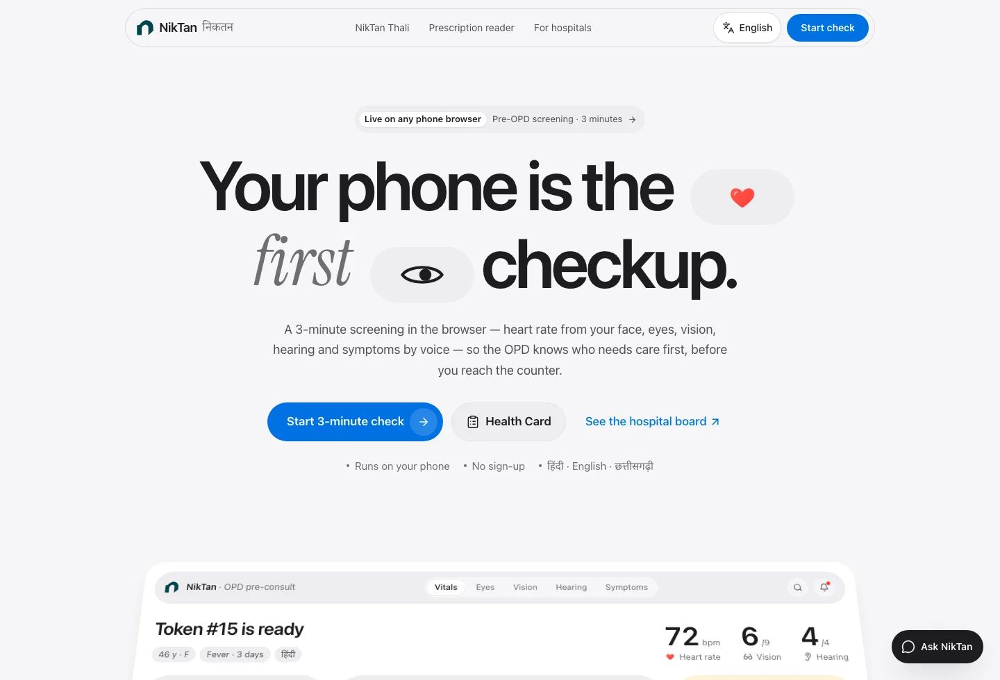](images/live/home.webp)

## Starting a screening

Consent describes which inputs stay on the device and which may be sent for processing. The profile collects age, sex and, where applicable, pregnancy status. First-time visitors who open **Health Card** can start screening from the empty state.

| Consent | Profile | Health Card before screening |
|---|---|---|
| [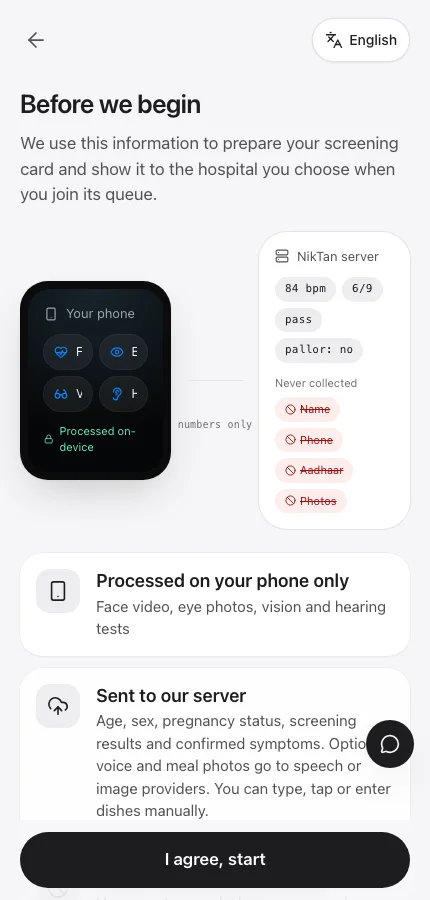](images/live/consent.webp) | [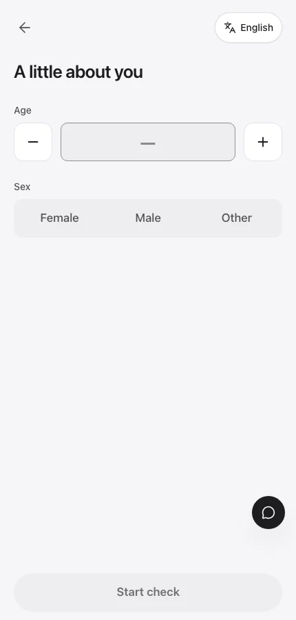](images/live/profile.webp) | [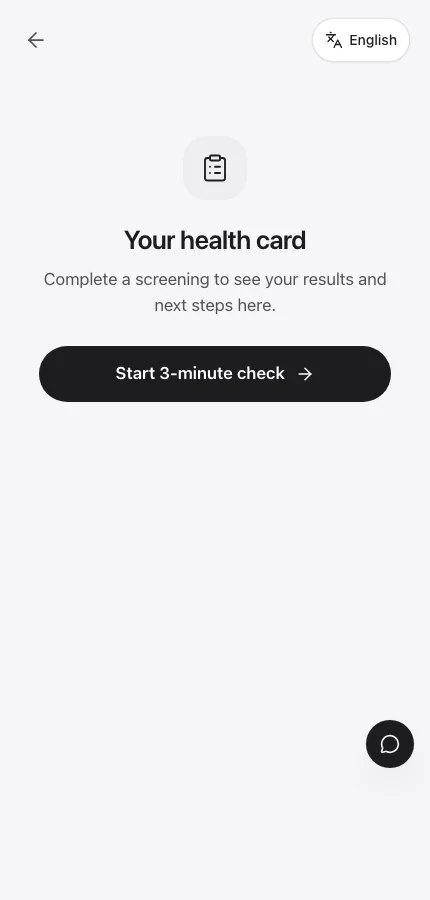](images/live/health-card-empty.webp) |

The profile offers **Quick check** (pulse, eyes and symptoms, about 3 minutes) and **Full check** (adds vision and hearing, about 8 minutes). The Health Card can reopen skipped checks and update the priority of a queued visit. Both durations are estimates.

## Screening steps

| Screen | What the user can do |
|---|---|
| [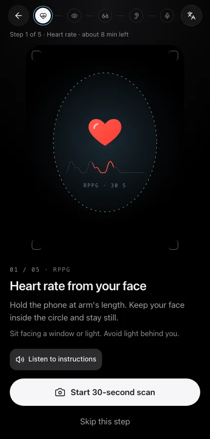](images/live/face-vitals.webp) | **Face pulse.** Position the phone and estimate pulse with its camera. The screen provides framing and lighting guidance. |
| [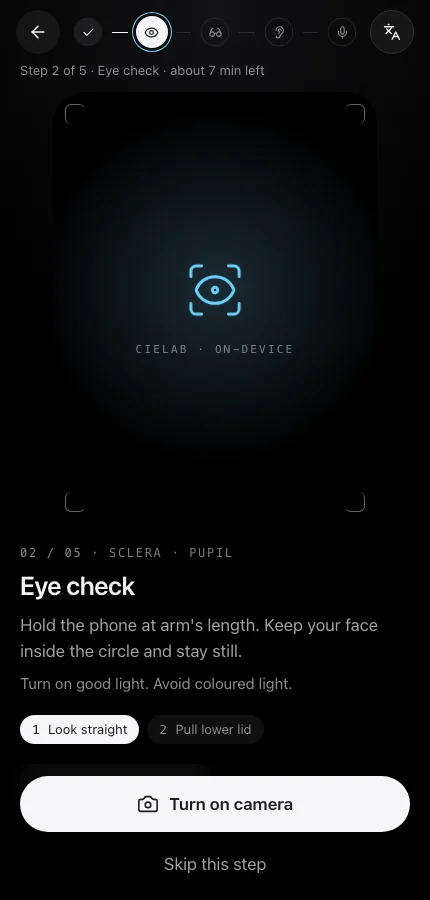](images/live/eye-check.webp) | **Eye check.** Follow the capture guidance to check for pallor, scleral yellowness and visible lens opacity. Symptom questions inform the jaundice and cataract flags. |
| [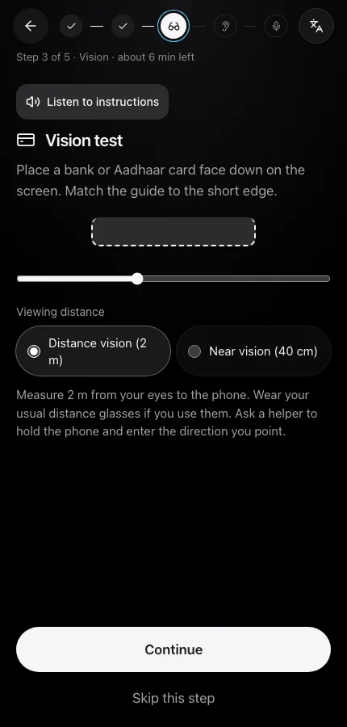](images/live/vision-test.webp) | **Vision.** Select 40 cm or 2 m, calibrate the display and answer the directional E test. Additional checks cover contrast, red–green colour and uneven dial lines. [See an active vision trial](images/live/vision-trial.webp). |
| [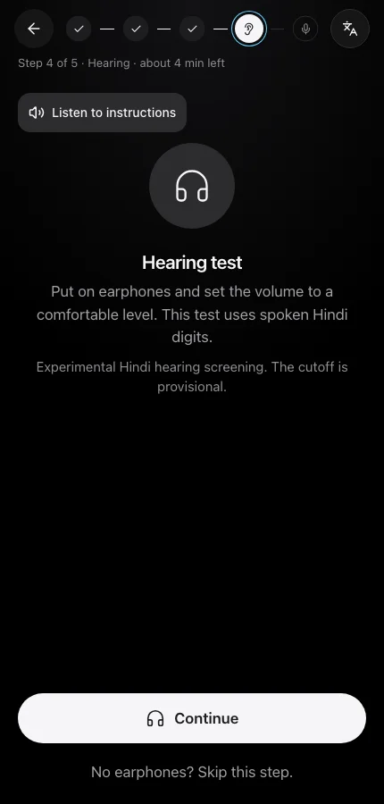](images/live/hearing-test.webp) | **Hearing.** Set a comfortable volume, then follow the Hindi digits-in-noise test and the optional per-ear tone screen. |
| [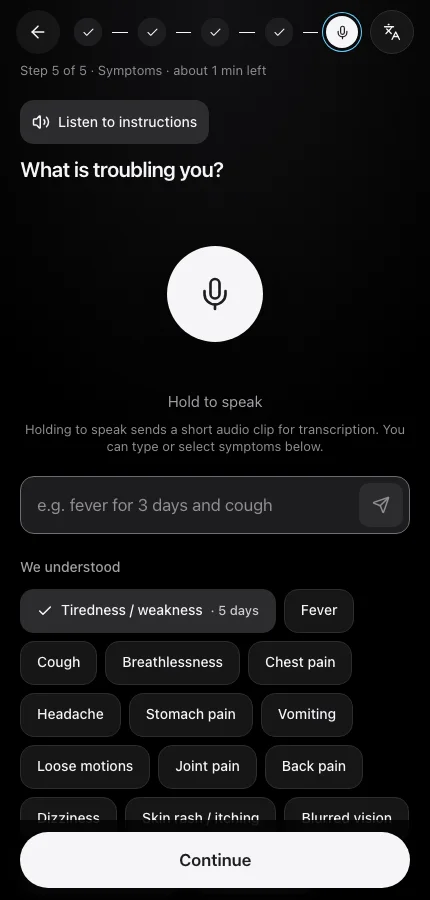](images/live/symptoms.webp) | **Symptoms.** Speak, type or choose symptoms. Review the result and confirm any red flags before triage. |

## Health Card and OPD queue

The Health Card shows the suggested next step, department and screening observations. For an eligible OPD visit, the queue shows the token, estimated wait and number of patients ahead. Emergency guidance appears on the Health Card when the triage rules call for immediate care.

| Health Card with example results | Example OPD queue token |
|---|---|
| [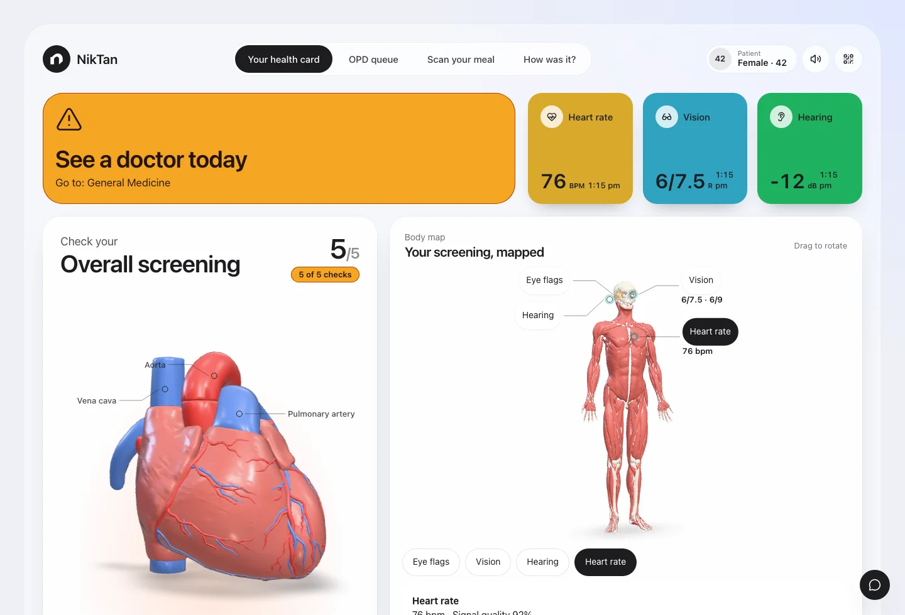](images/live/health-card.webp) | [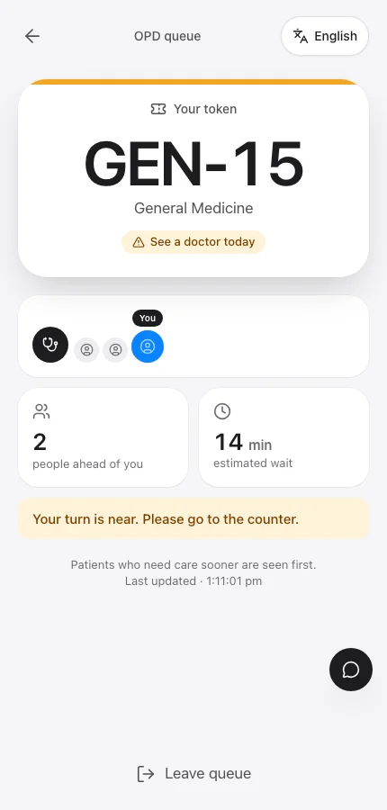](images/live/opd-queue.webp) |

The Health Card uses adapted BodyParts3D heart and body models © DBCLS, CC BY 4.0. [Anatomy model attribution and modifications](../apps/web/public/models/ATTRIBUTION.txt)

## Thali, Health Papers and help

| Start | Review |
|---|---|
| [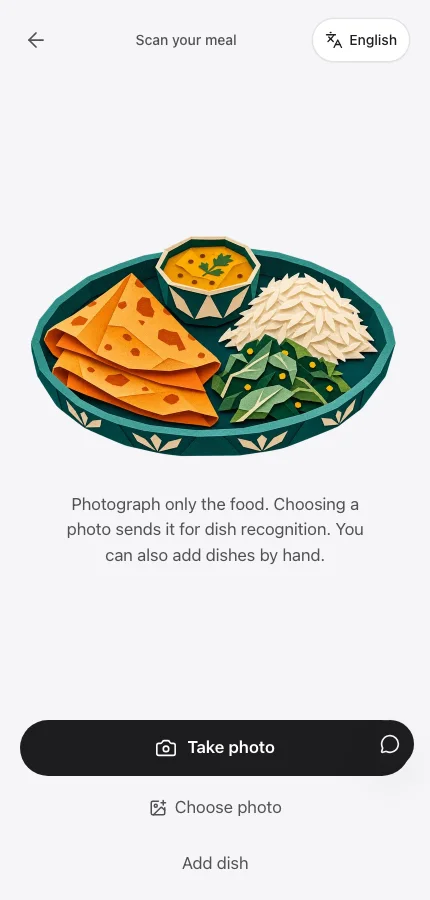](images/live/thali.webp) | [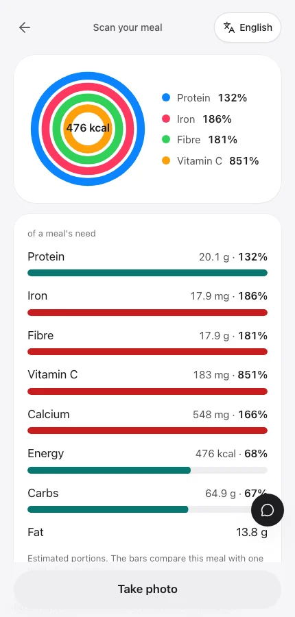](images/live/thali-results.webp) |
| [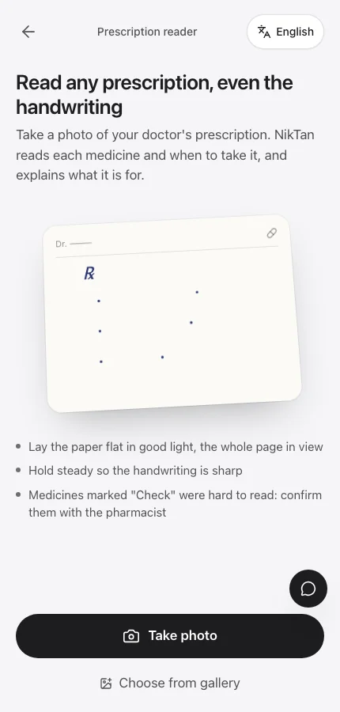](images/live/prescription.webp) | [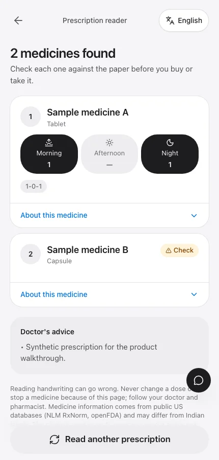](images/live/prescription-results.webp) |

**NikTan Thali** accepts a meal photo or manually selected dishes. Review portions and see estimated nutrients from the dish catalogue. The **Prescription reader** extracts entries and highlights uncertain text for review against the original. The reader result here uses fictional medicine names. [Open Thali](https://niktan.vercel.app/thali) · [Open Prescription reader](https://niktan.vercel.app/rx)

**Health Papers** also includes Medicine Saver, which matches a medicine’s ingredients, strength and form against the Jan Aushadhi price list, and a lab reader that compares transcribed values with the report’s ranges or a labelled fallback. Each tool includes a demo sample. [Medicine Saver](https://niktan.vercel.app/rx?tool=saver) · [Lab reader](https://niktan.vercel.app/rx?tool=lab)

The home page features the 36-second launch film, post-check survey aggregates and public team reviews. **Rate NikTan** in the footer opens the Hackasol team form. [Review NikTan](https://niktan.vercel.app/review)

**NikTan Sahayak** answers questions about the app and links to relevant screens. Use **Feedback** to rate a visit workflow and **Service status** to check API availability. [Open Feedback](https://niktan.vercel.app/feedback) · [Open Service status](https://niktan.vercel.app/status)

| Help assistant | Feedback | Service status |
|---|---|---|
| [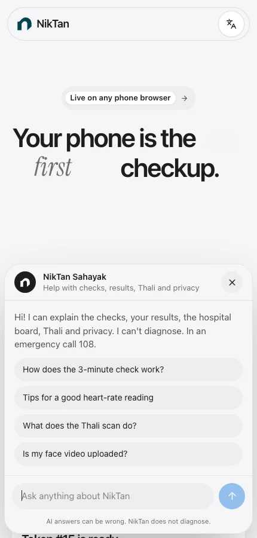](images/live/sahayak.webp) | [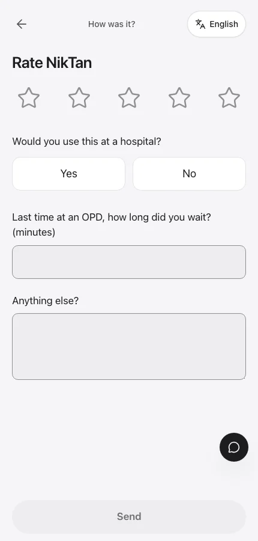](images/live/feedback.webp) | [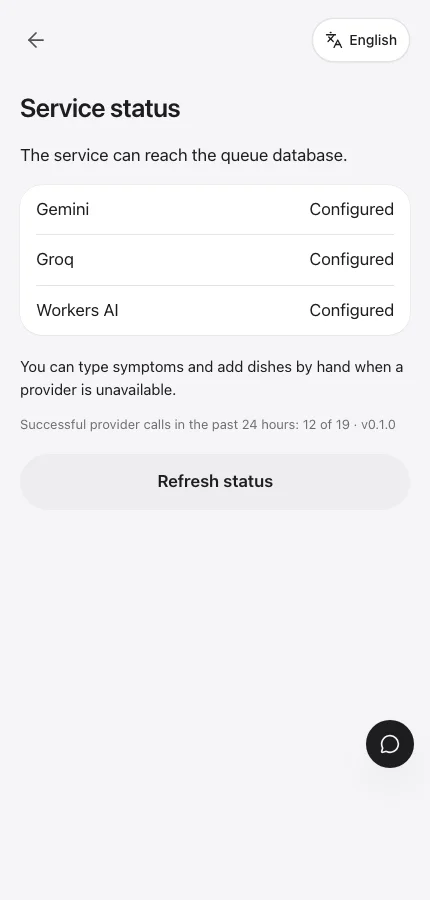](images/live/service-status.webp) |

## Hospital workspace

Staff sign in with a hospital PIN. The triage board groups visits by department and consultation state. Opening a token shows the pre-consult card and provides note and consult controls. The admin dashboard aggregates queue activity and separates simulated from real usage. [Open staff sign-in](https://niktan.vercel.app/hospital)

| Staff sign-in | Triage board |
|---|---|
| [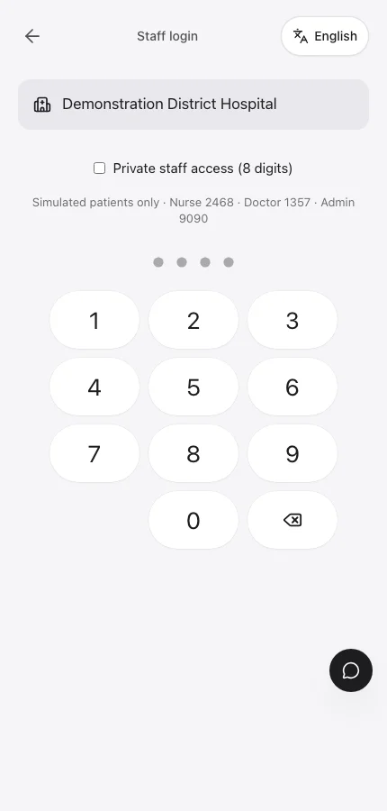](images/live/staff-login.webp) | [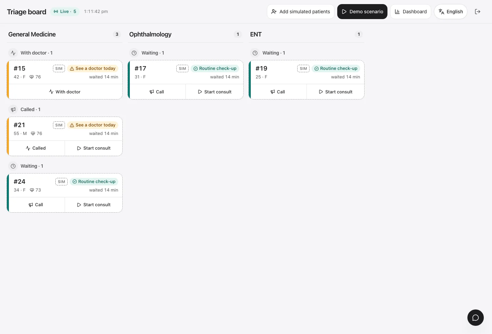](images/live/staff-board.webp) |

| Pre-consult card | Admin dashboard |
|---|---|
| [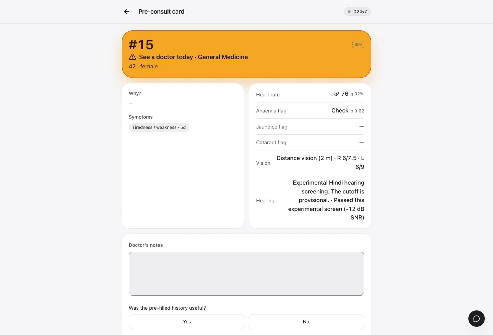](images/live/pre-consult-card.webp) | [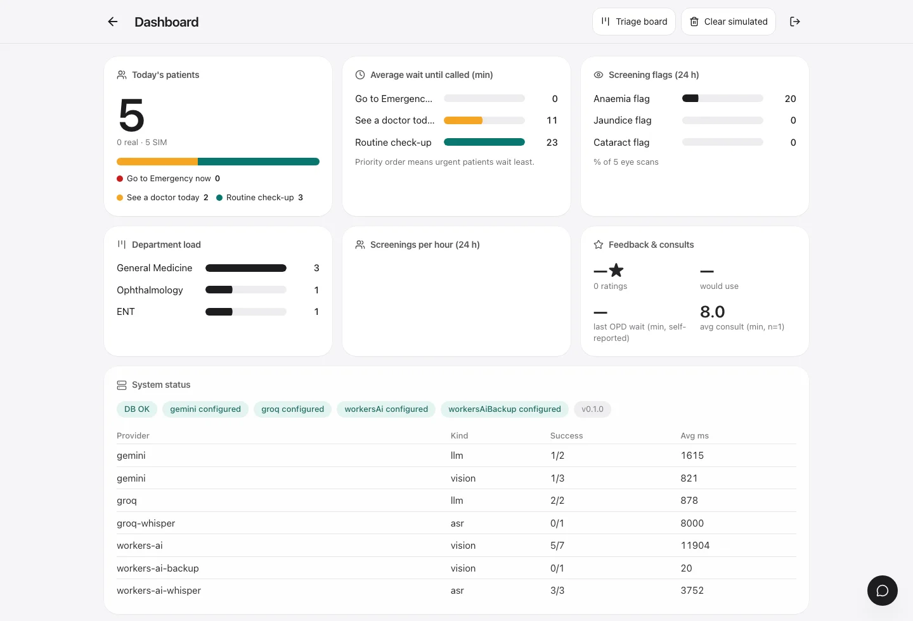](images/live/staff-dashboard.webp) |

A patient joining a demo hospital can select **Show my visit on the demo board**. Any demo staff PIN can also seed simulated visits. The board compares call times with arrival order at the same capacity, and the admin dashboard breaks that comparison down by priority.

## Capture notes

The screenshots were captured from the Vercel production frontend on November 23, 2026, in Chromium at 430 px mobile and 1440 px desktop widths. Screening results, OPD tokens, prescription output and staff data use synthetic fixtures delivered in the browser. The Thali totals use manually selected example portions. Screenshots illustrate the user interface. Clinical validation and measured impact are documented separately. [Architecture](architecture.md) · [Validation](validation.md) · [Evaluation](metrics.md)
